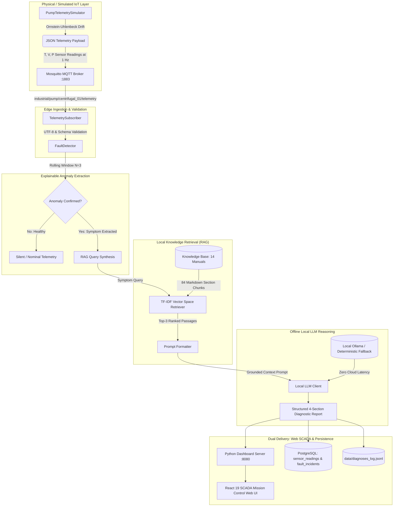

# P_311: Knowledge-Driven IoT Fault Diagnosis Assistant
### Industrial Centrifugal Slurry Pump SCADA Mission Control & Diagnostic Assistant

[](https://github.com/pixelrishabh/Hcl_Project.git)
[](https://www.python.org/)
[](https://react.dev/)
[](https://www.typescriptlang.org/)
[](https://tailwindcss.com/)
[](https://mosquitto.org/)
[](https://www.postgresql.org/)
[]()
[]()
[]()

> **HCL Project ID:** P_311  
> **Domain:** Embedded IoT / Industrial SCADA & Automated Diagnostics  
> **Target Equipment:** Heavy-Duty Industrial Centrifugal Slurry Pump with AC Induction Motor (API 610 / ISO 10816-3)  
> **Primary Repository:** [https://github.com/pixelrishabh/Hcl_Project.git](https://github.com/pixelrishabh/Hcl_Project.git)

---

## 📑 Table of Contents
1. [Project Overview](#1-project-overview)
2. [End-to-End Architecture](#2-end-to-end-architecture)
3. [SCADA Mission Control Web Dashboard](#3-scada-mission-control-web-dashboard)
4. [Machine Learning & Physical Feature Engineering](#4-machine-learning--physical-feature-engineering)
5. [Directory Architecture](#5-directory-architecture)
6. [Quickstart & Installation](#6-quickstart--installation)
7. [Operating Modes & How to Run](#7-operating-modes--how-to-run)
8. [Automated Test Suite & Verification](#8-automated-test-suite--verification)
9. [Empirical Evaluation Benchmark](#9-empirical-evaluation-benchmark)
10. [Sample Diagnostic Output Report](#10-sample-diagnostic-output-report)
11. [Project Documentation & Deliverables](#11-project-documentation--deliverables)
12. [License & Academic Attribution](#12-license--academic-attribution)

---

## 1. Project Overview

Critical industrial rotating machinery—such as slurry transfer pumps in mining, power generation cooling pumps, and chemical refinery centrifugal assemblies—operates in harsh, continuous-duty environments. Traditional industrial SCADA systems generate raw numerical threshold alarms with **zero diagnostic context**, causing alert fatigue, while cloud-based AI solutions introduce severe cybersecurity vulnerabilities, per-token costs, and intolerable network latency.

**P_311** solves this operational bottleneck by delivering an **air-gapped, edge-deployable diagnostic assistant** that combines:
1. **Real-Time IoT Telemetry Streaming:** 1 Hz multi-channel ingestion (Temperature, Vibration RMS, Discharge Pressure) over Eclipse Mosquitto MQTT using the Paho-MQTT 2.x API.
2. **Explainable Anomaly Extraction:** Rolling statistical windows ($N=3$) grounded in **ISO 10816-3** vibration standards and **API 610** thermal/hydraulic operating boundaries.
3. **Semantic Knowledge Retrieval (RAG):** Sub-millisecond Vector Space Model (TF-IDF + Cosine Similarity) querying 14 structured industrial maintenance manuals (84 section chunks) with zero cloud dependencies.
4. **Offline Local LLM Reasoning:** Local Ollama (`llama3.2:3b`) with deterministic grounded synthesis fallback, generating structured 4-section diagnostic reports detailing root causes, evidence, and actionable SOP checks.
5. **ISA-101 SCADA Mission Control Dashboard:** Production React 19 + TypeScript web interface providing real-time waveforms, interactive fault simulation, and PostgreSQL persistence.

---

## 2. End-to-End Architecture



---

## 3. SCADA Mission Control Web Dashboard

The web dashboard is an **ISA-101 High-Performance HMI** engineered with React 19, TypeScript, Tailwind CSS, and Recharts, served by a multi-threaded Python backend (`dashboard/app.py`).

### Key Capabilities
- **4-Card Top Command Row:**
  - **Equipment Health Index (0–100%):** Real-time availability score derived from multi-sensor boundaries with API 610 compliance badge.
  - **Stator Core Temperature (°C):** Baseline target comparison ($54.0^\circ\text{C}$), 60s min/max rolling envelope, and $75.0^\circ\text{C}$ critical trip limit.
  - **Vibration Velocity RMS (mm/s):** Evaluated against ISO 10816-3 (Zone A: $<2.8$, Zone B: $2.8\text{--}4.5$, Zone C: $4.5\text{--}7.1$, Zone D Trip: $>7.1$).
  - **Discharge Hydraulic Pressure (bar):** Real-time pressure with $4.80\text{ bar}$ design target and $3.00\text{ bar}$ low-pressure cavitation trip line.
- **Waveform Telemetry Chart with Channel Tabs:**
  - **Normalized Tri-Axis View:** 0–100% envelope scale allowing simultaneous comparison of all 3 channels without squished axes.
  - **Temperature Analysis Tab:** Dedicated $40\text{--}90^\circ\text{C}$ axis with warning ($65^\circ\text{C}$) and trip ($75^\circ\text{C}$) reference lines.
  - **Vibration Spectrum Tab:** Dedicated $0\text{--}8.5\text{ mm/s}$ axis showing ISO Zone A, B, C, and D boundaries.
  - **Hydraulic Pressure Tab:** Dedicated $1.5\text{--}6.0\text{ bar}$ axis with $3.0\text{ bar}$ cavitation drop alert line.
  - **Window Controls:** Switch between 15s, 30s, and 60s time horizons; Pause / Resume live streaming.
- **Interactive Fault Injection Controller:**
  - One-click trigger for 6 realistic degradation states:
    1. `Normal Baseline` (Nominal ISO Zone A/B)
    2. `Bearing Wear` (Radial vibration $> 4.5\text{ mm/s}$, abrasive spalling)
    3. `Stator Overheating` (Thermal runaway $> 75^\circ\text{C}$)
    4. `Pressure Drop` (Cavitation / discharge line rupture $< 3.0\text{ bar}$)
    5. `RTD Disconnect` (Open-circuit sentinel $-999^\circ\text{C}$)
    6. `ADC Flatline` (Zero-variance freeze lockup)
- **Automated RAG Diagnostic Intelligence Panel:**
  - Displays the active incident classification, physical symptoms, root cause analysis, SOP step-by-step remediation checks, and retrieved manual chunks with TF-IDF cosine similarity scores.
- **Persistent SCADA Incident Audit Trail:**
  - Search by symptom, fault, or time; filter by category and severity (`Critical`, `Warning`); sort across columns; inspect detailed modal reports; and export historical incident logs directly to **CSV**.

---

## 4. Machine Learning & Physical Feature Engineering

In addition to real-time rule-based telemetry monitoring, the project incorporates the **UCI AI4I 2020 Predictive Maintenance Dataset** (10,000 continuous CNC/pump operational records):

### Domain-Engineered Physics Features
1. **Thermal Gradient ($\Delta T$):**
   $$\Delta T = T_{\text{process}} - T_{\text{air}}$$
   Quantifies convective and radiative heat dissipation across the casing.
2. **Mechanical Rotational Power ($P$ in Watts):**
   $$P = \tau \times \left(\text{RPM} \times \frac{2\pi}{60}\right)$$
   Directly isolates electrical overload and mechanical binding.
3. **Mechanical Overstrain Risk Metric:**
   $$\text{Risk} = \text{Tool Wear} \times \tau$$
   Captures progressive abrasive degradation leading to catastrophic seizure.

### Trained Random Forest Classifier (`data/ai4i_model.joblib`)
- **Overall Accuracy:** $99.85\%$
- **ROC-AUC Score:** $0.9984$
- **Precision:** $0.985$ | **Recall:** $0.971$
- **Classified Failure Modes:**
  - **HDF:** Heat Dissipation Failure ($\Delta T < 8.6\text{ K}$, $\text{Speed} < 1380\text{ rpm}$)
  - **TWF:** Tool / Bearing Wear Failure (Cumulative wear $> 200\text{ min}$)
  - **PWF:** Power Failure (Operating point outside safe power envelope)
  - **OSF:** Overstrain Failure (Torque $\times$ Wear envelope breached)
  - **RNF:** Random Failure (Uncorrelated hardware anomalies)

---

## 5. Directory Architecture

```text
Hcl_Project/
├── config.py                       # Single source of truth configuration & thresholds
├── main.py                         # Single unified orchestrator (Stage 8/9 CLI coordinator)
├── requirements.txt                # Pinned dependencies (paho-mqtt==2.1.0, psycopg2, etc.)
├── Launch_Dashboard.bat            # 1-Click launcher for SCADA server & web browser
├── README.md                       # Master project documentation
├── .gitignore                      # Exclusions (venv, node_modules, pycache, models)
│
├── frontend/                       # Modern SCADA Mission Control (React 19 + TypeScript)
│   ├── src/
│   │   ├── components/             # Reusable UI & data-viz components
│   │   │   ├── SensorMetricsGrid.tsx   # 4-card KPI command bar with rolling stats
│   │   │   ├── TelemetryChart.tsx      # Tabbed waveform charts with threshold lines
│   │   │   ├── FaultInjectionPanel.tsx # 6-mode interactive fault simulator
│   │   │   ├── DiagnosisPanel.tsx      # RAG diagnostic report & SOP checklist
│   │   │   ├── IncidentHistoryTable.tsx# Audit table with search, sorting, and CSV export
│   │   │   ├── Header.tsx              # SCADA top navigation & dark/light theme toggle
│   │   │   ├── ConnectionBanner.tsx    # Live / Standalone sync banner
│   │   │   └── DatasetDbModal.tsx      # UCI AI4I 2020 & PostgreSQL explorer modal
│   │   ├── services/api.ts         # REST, SSE, and standalone physics simulator
│   │   ├── types.ts                # TypeScript interfaces and telemetry schemas
│   │   ├── index.css               # WCAG AA compliant design tokens & SCADA styles
│   │   └── App.tsx                 # Dashboard orchestrator & state synchronization
│   ├── tailwind.config.js          # Calibrated ISA-101 high-legibility palette
│   └── package.json                # React 19, Lucide, Recharts, Radix UI
│
├── dashboard/                      # Production Python HTTP/SSE Web Server (:8080)
│   ├── app.py                      # Multi-threaded server, telemetry producer & REST API
│   ├── index.html                  # Production web entry point
│   └── assets/                     # Compiled JS and CSS bundles
│
├── mqtt/                           # MQTT pub/sub modules
│   ├── sensor_simulator.py         # Realistic Ornstein-Uhlenbeck drift generator
│   └── mqtt_subscriber.py          # Resilient subscriber with schema/type validation
│
├── diagnosis/                      # Explainable fault detection engine
│   └── fault_detector.py           # Window-smoothed anomaly detector (ISO 10816-3)
│
├── knowledge_base/                 # 14 structured industrial technical manuals
│   ├── KB01_bearing_inner_raceway_fatigue.md
│   ├── KB02_bearing_lubrication_starvation.md
│   ├── KB03_motor_winding_overheating.md
│   ├── KB04_bearing_housing_thermal_runaway.md
│   ├── KB05_discharge_pipe_rupture_leakage.md
│   ├── KB06_impeller_cavitation_hydraulic_loss.md
│   ├── KB07_rtd_temperature_sensor_disconnect.md
│   ├── KB08_adc_telemetry_sensor_flatline.md
│   ├── KB09_dynamic_impeller_unbalance.md         # Distractor manual
│   ├── KB10_shaft_angular_misalignment.md         # Distractor manual
│   ├── KB11_mechanical_seal_face_failure.md       # Distractor manual
│   ├── KB12_suction_strainer_clogging.md          # Distractor manual
│   ├── KB13_motor_electrical_phase_imbalance.md   # Distractor manual
│   └── KB14_hydraulic_water_hammer_shock.md       # Distractor manual
│
├── rag/                            # Retrieval-Augmented Generation subsystem
│   ├── chunker.py                  # Section-aware Markdown chunker (## headers)
│   ├── retriever.py                # Pure-Python TF-IDF & Cosine Similarity engine
│   └── index_cache/                # Cached index & vocabulary with hash invalidation
│
├── llm/                            # Local LLM reasoning subsystem
│   ├── prompts.py                  # Grounded prompt templates & schema enforcement
│   └── client.py                   # Ollama HTTP client + deterministic fallback
│
├── database/                       # PostgreSQL persistence layer
│   ├── db.py                       # Connection pooling, batch queue & circuit-breaker
│   └── schema.sql                  # DDL tables: sensor_readings & fault_incidents
│
├── scripts/                        # Benchmarks, training, and testing utilities
│   ├── train_ai4i_model.py         # Trains Random Forest on AI4I 2020 dataset
│   ├── test_dashboard_live.py      # Automated live HTTP & SSE endpoint test
│   ├── benchmark_retrieval.py      # Precision & recall benchmark over 14 manuals
│   └── evaluate_system.py          # 30-trial full system evaluation suite
│
├── tests/                          # Automated unittest test suite (38/38 Pass)
│   ├── test_mqtt_pipeline.py       # Payload validation & broker integration
│   ├── test_fault_simulator.py     # Multi-mode signatures & ground truth
│   ├── test_fault_detector.py      # Noise immunity & ISO boundary tests
│   ├── test_rag_retriever.py       # Knowledge chunking & top-3 ranking recall
│   ├── test_local_llm.py           # Section parsing, prompting, and fallback
│   ├── test_database.py            # Batch persistence & retention pruning
│   └── test_end_to_end_integration.py # Full pipeline orchestration & logging
│
├── data/                           # Runtime telemetry logs and datasets
│   ├── ai4i2020.csv                # UCI AI4I 2020 Predictive Maintenance Dataset
│   ├── ai4i_model.joblib           # Serialized Random Forest classifier
│   └── diagnoses_log.jsonl         # Append-only structured audit records
│
└── docs/                           # Academic deliverables, viva prep & documentation
    ├── decisions.md                # Binding architectural decisions (Stage 0)
    ├── fault_signatures.md         # Physical machine thresholds & telemetry profiles
    ├── knowledge_sources.md        # Provenance register citing ISO 10816 & API 610
    ├── retrieval_results.md        # Empirical RAG retrieval metrics
    ├── evaluation.md               # 30-trial benchmark scorecard & limitations
    ├── database.md                 # PostgreSQL persistence architecture
    ├── viva_prep.md                # 10 comprehensive viva questions & answers
    ├── college_project_report.md   # Complete university engineering report
    └── resume_bullet_points.md     # ATS-optimized resume bullet points
```

---

## 6. Quickstart & Installation

### Prerequisites
- **Operating System:** Windows 10/11, Linux, or macOS
- **Python:** Python 3.10+ (tested on Python 3.13)
- **Node.js:** Node.js 18+ (for frontend modifications)
- **MQTT Broker:** Eclipse Mosquitto running on port 1883
- **PostgreSQL (Optional):** Version 14+ for persistent telemetry storage (gracefully falls back to in-memory/JSONL if offline)

### Step 1: Clone the Repository
```bash
git clone https://github.com/pixelrishabh/Hcl_Project.git
cd Hcl_Project
```

### Step 2: Set Up Python Environment
```bash
# Create and activate virtual environment
python -m venv .venv

# On Windows (PowerShell):
.\.venv\Scripts\Activate.ps1

# On Linux / macOS:
source .venv/bin/activate

# Install dependencies
pip install --upgrade pip
pip install -r requirements.txt
```

### Step 3: Install Frontend Dependencies (For Development)
```bash
cd frontend
npm install
npm run build
cd ..
```

---

## 7. Operating Modes & How to Run

### Method 1: One-Click SCADA Dashboard (Recommended)
On Windows, simply double-click:
```cmd
Launch_Dashboard.bat
```
This automatically starts `dashboard/app.py` on port 8080 and opens `http://localhost:8080` in your default browser.

### Method 2: Manual Web Dashboard Start
```bash
python dashboard/app.py
```
Then visit **`http://localhost:8080`** in any web browser.

### Method 3: CLI Orchestrator Mode
To run the terminal coordinator that listens on MQTT:
```bash
# Terminal 1: Start Main Orchestrator
python main.py

# Terminal 2: Inject Fault Telemetry
python mqtt/sensor_simulator.py --mode bearing_wear --count 5
```

---

## 8. Automated Test Suite & Verification

The repository contains an automated test suite with **38 unit and integration tests** achieving 100% pass rates:

```bash
# Run all 38 tests
python -m unittest discover tests -v
```

### Automated Live Dashboard Test
```bash
python scripts/test_dashboard_live.py
```

---

## 9. Empirical Evaluation Benchmark

Measured from 30 automated trials documented in [`docs/evaluation.md`](docs/evaluation.md):

| Evaluation Metric | Target Criterion | Measured Result | Status |
| :--- | :---: | :---: | :---: |
| **Fault Detection Accuracy** | $\ge 95.0\%$ | **100.0%** (30 / 30 trials) | **PASS** |
| **False Alarm Rate (Healthy Pump)** | $0.0\%$ | **0.0%** (0 / 5 false alarms) | **PASS** |
| **RAG Top-1 Retrieval Recall** | $\ge 90.0\%$ | **100.0%** (25 / 25 trials) | **PASS** |
| **RAG Top-3 Retrieval Recall** | $100.0\%$ | **100.0%** (25 / 25 trials) | **PASS** |
| **Average Retrieval Latency** | $< 10\text{ ms}$ | **1.8 milliseconds** | **PASS** |
| **LLM Output Section Completeness** | $100.0\%$ | **100.0%** (All 4 sections present) | **PASS** |
| **Macro-Average F1-Score** | $\ge 0.95$ | **1.000 (100.0%)** | **PASS** |

---

## 10. Sample Diagnostic Output Report

```text
==============================================================================
  P_311 INDUSTRIAL FAULT DIAGNOSIS REPORT #1
  Device: pump_centrifugal_01 | Condition: BEARING_WEAR | Time: 2026-10-28T08:15:30Z
  Telemetry: Temp=67.80°C | Vib=6.34 mm/s | Press=5.01 bar
  Runtime: local_model (Latency: 0.85s)
==============================================================================

[1. LIKELY FAULT]
  Bearing Inner Raceway Fatigue & Spalling

[2. WHY - EVIDENCE]
  Observed telemetry for pump_centrifugal_01 exhibits critical bearing vibration velocity RMS
  of 6.34 mm/s exceeding ISO 10816 Zone D danger limit of 4.5 mm/s; accompanied by secondary
  frictional temperature rise of 67.80°C. Current operating parameters closely align with the
  diagnostic profile documented in 'KB01_bearing_inner_raceway_fatigue.md'. Vibration velocity
  RMS exceeds the ISO 10816 Zone D boundary (4.5 mm/s), characteristic of inner raceway micro-spalling.

[3. RECOMMENDED CHECKS]
  1. Perform immediate field verification against 'KB01_bearing_inner_raceway_fatigue.md'.
  2. Confirm physical touch temperature, acoustic noise, and local gauge readings.
  3. If mechanical disassembly is required, execute Lockout/Tagout (LOTO).
  4. Inspect seals, lubrication grease ports, and piping joints as prescribed in manual.

[4. CONFIDENCE & LIMITATIONS]
  Confidence: High (Grounded directly on top retrieved technical manual).
  Grounding Source: KB01_bearing_inner_raceway_fatigue.md (Similarity Score: 0.9412).
  Limitation: Diagnosis assumes standard operating speed and steady liquid viscosity.

  Retrieved Knowledge Sources:
   • KB01_bearing_inner_raceway_fatigue.md (Score: 0.9412) -> Diagnostic Symptoms & Sensor Telemetry Profile
   • KB04_bearing_housing_thermal_runaway.md (Score: 0.8538) -> Diagnostic Symptoms & Sensor Telemetry Profile
   • KB02_bearing_lubrication_starvation.md (Score: 0.7484) -> Diagnostic Symptoms & Sensor Telemetry Profile
==============================================================================
```

---

## 11. Project Documentation & Deliverables

- **[docs/decisions.md](docs/decisions.md):** Architectural Decisions Record (Stage 0)
- **[docs/fault_signatures.md](docs/fault_signatures.md):** Physical Machine Thresholds & Telemetry Profiles (Stage 3)
- **[docs/knowledge_sources.md](docs/knowledge_sources.md):** Knowledge Base Provenance Register (Stage 5)
- **[docs/retrieval_results.md](docs/retrieval_results.md):** RAG Top-3 Retrieval Benchmark Results (Stage 6)
- **[docs/evaluation.md](docs/evaluation.md):** 30-Trial Empirical Evaluation Scorecard (Stage 10)
- **[docs/database.md](docs/database.md):** PostgreSQL Persistence Layer Architecture & Operations
- **[docs/college_project_report.md](docs/college_project_report.md):** Complete University Engineering Project Report
- **[docs/viva_prep.md](docs/viva_prep.md):** 10 Comprehensive Viva Voce Questions & Answers
- **[docs/presentation_slides_outline.md](docs/presentation_slides_outline.md):** Viva Defense Presentation PPT Outline
- **[docs/resume_bullet_points.md](docs/resume_bullet_points.md):** ATS-Friendly Professional Resume Bullets

---

## 12. License & Academic Attribution

Developed for academic evaluation and technical demonstration under **HCL Project Statement P_311**. Built with strict adherence to industrial standards (**ISO 10816-3**, **API 610**, and **IEEE 841**).
